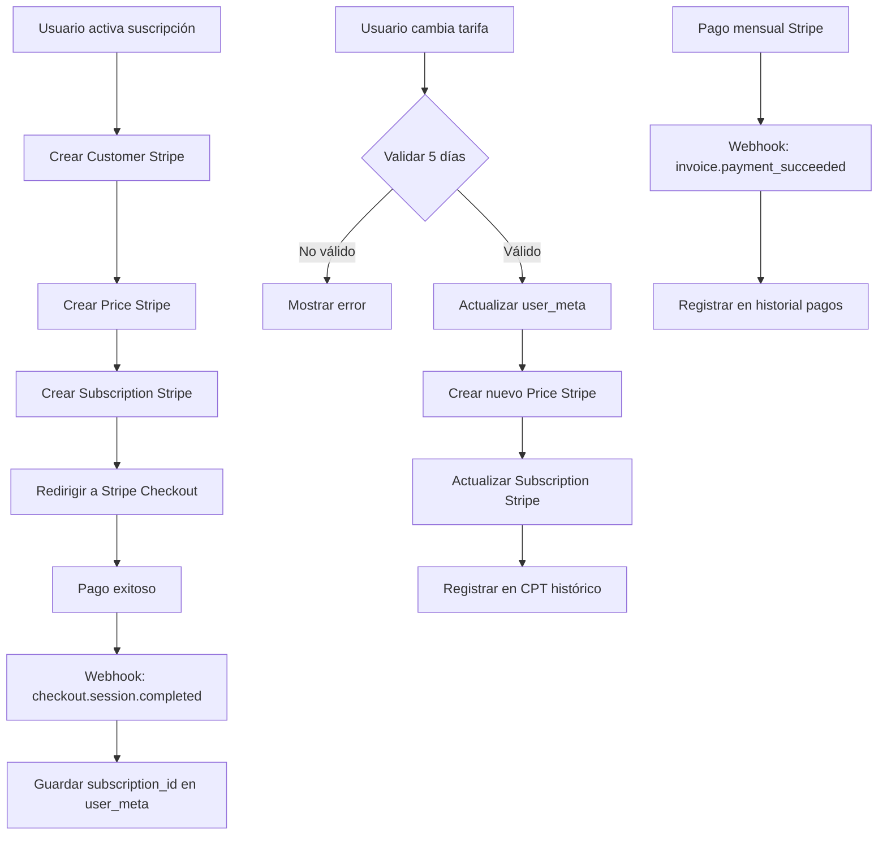

# Sistema de Suscripciones para Club Triatlón Sulayr (Sin WooCommerce Subscriptions)

## Arquitectura General

El sistema utilizará **Stripe Subscriptions API directamente** mediante el SDK de PHP de Stripe. No se requiere WooCommerce Subscriptions. Los productos en WooCommerce serán productos normales (no de suscripción) que servirán como referencia, pero toda la lógica de suscripciones se gestionará directamente con Stripe.

## Componentes Principales

### 1. Instalación de Stripe PHP SDK

- Instalar `stripe/stripe-php` vía Composer
- Configurar credenciales de API (claves secretas y públicas)
- Configurar webhooks en Stripe Dashboard

### 2. Productos de Referencia en WooCommerce

Crear 3 productos normales en WooCommerce (tipo `simple`) como referencia:

- **Tarifa Básica**: 22€ (producto simple, no suscripción)
- **Tarifa Entrenamientos**: 33€ (producto simple, no suscripción)  
- **Suplemento Natación**: 25€ (producto simple, no suscripción)

Estos productos:

- Son editables (precio y nombre) desde WooCommerce
- Tienen metadatos personalizados `_sulayr_membership_type` para vincularlos con user_metas
- NO se usan para checkout, solo como referencia para precios y nombres

### 3. Gestión de Suscripciones con Stripe

#### 3.1 Estructura de Datos

**User Meta para almacenar suscripciones:**

- `sulayr_stripe_customer_id`: ID del cliente en Stripe
- `sulayr_stripe_subscription_id`: ID de la suscripción activa en Stripe
- `sulayr_subscription_status`: Estado de la suscripción (active, canceled, past_due, etc.)
- `sulayr_subscription_plan`: Plan actual (basic/premium)
- `sulayr_subscription_swimming`: Si tiene suplemento (1/0)
- `sulayr_subscription_next_payment`: Fecha del próximo pago

#### 3.2 Proceso de Creación de Suscripción

1. Usuario hace clic en "Activar suscripción"
2. Crear o recuperar Customer en Stripe
3. Crear Price en Stripe (si no existe) basado en tarifa + suplemento
4. Crear Subscription en Stripe con el Price
5. Obtener PaymentIntent y redirigir a Stripe Checkout
6. Tras pago exitoso, guardar subscription_id en user_meta

### 4. Integración con Stripe

#### 4.1 Webhooks de Stripe

Configurar webhooks para:

- `checkout.session.completed`: Confirmar suscripción iniciada
- `invoice.payment_succeeded`: Registrar pago mensual exitoso
- `invoice.payment_failed`: Notificar fallo de pago
- `customer.subscription.updated`: Sincronizar cambios de suscripción
- `customer.subscription.deleted`: Manejar cancelaciones

#### 4.2 Endpoint de Webhook

Crear endpoint REST API: `/wp-json/sulayr/v1/stripe-webhook`

### 5. Gestión de Suscripciones

#### 5.1 Inicio de Suscripciones

**Desde el Dashboard del Usuario:**

- Botón "Activar suscripción" en endpoint `perfil-deportista`
- Validar que el usuario tenga tarifa asignada
- Crear sesión de Stripe Checkout con suscripción
- Redirigir a Stripe para pago inicial

**Desde el Admin:**

- Permitir a administradores crear suscripciones manualmente
- Opción para crear suscripción sin pago inicial (para casos especiales)

#### 5.2 Cambios de Suscripción

**Validación de 5 días:**

- Validar cambios con al menos 5 días antes del inicio del próximo mes
- Aplicar validación tanto para cambios desde dashboard como desde admin

**Proceso de cambio:**

1. Validar margen de 5 días
2. Si es válido:

   - Calcular nuevo precio (tarifa + suplemento)
   - Crear nuevo Price en Stripe si no existe
   - Actualizar Subscription en Stripe usando `subscription.modify()` o `subscription.update()`
   - El nuevo precio se aplicará en el próximo ciclo

3. Actualizar user_meta
4. Registrar cambio en CPT histórico

### 6. Historial de Pagos en Dashboard

**Nuevo endpoint:** `mis-pagos` en WooCommerce My Account

- Consultar invoices de Stripe para el customer_id del usuario
- Mostrar listado de pagos con formato: "Tarifa básica + suplemento natación - 47 € - 01/04/2026"
- Mostrar estado de cada pago (pagado, fallido, pendiente)
- Integrar con sistema de monedero existente si es necesario

### 7. CPT para Histórico de Cambios de Tarifas

**Nuevo CPT:** `sulayr_subscription_changes`

**Campos ACF:**

- `sulayr_change_user`: Usuario sobre el que se hace el cambio (user field)
- `sulayr_change_made_by`: Persona que hace el cambio (user field)
- `sulayr_change_plan_before`: Tarifa antes del cambio
- `sulayr_change_plan_after`: Tarifa después del cambio
- `sulayr_change_swimming_before`: Suplemento antes del cambio (boolean)
- `sulayr_change_swimming_after`: Suplemento después del cambio (boolean)
- `sulayr_change_date`: Fecha del cambio
- `sulayr_change_effective_date`: Fecha efectiva del cambio (próximo ciclo)
- `sulayr_change_reason`: Motivo del cambio (opcional, textarea)
- `sulayr_stripe_subscription_id`: ID de suscripción en Stripe (para referencia)

**Título autogenerado:** `{nombre_usuario} - {fecha_cambio}`

**Registro automático:**

- Hook en `AthleteUpdate` para registrar cambios cuando se actualiza tarifa/suplemento
- Registrar tanto cambios desde dashboard como desde admin

## Flujo de Datos

## Archivos a Crear/Modificar

### Nuevos Archivos

1. **`src/Modules/Subscriptions/StripeService.php`**

   - Servicio principal para interactuar con Stripe API
   - Métodos: crear customer, crear price, crear subscription, actualizar subscription, cancelar subscription

2. **`src/Modules/Subscriptions/SubscriptionService.php`**

   - Servicio de alto nivel para gestionar suscripciones
   - Métodos: crear suscripción, actualizar suscripción, cancelar, obtener suscripción activa
   - Usa StripeService internamente

3. **`src/Modules/Subscriptions/SubscriptionChangeValidator.php`**

   - Validar cambios con margen de 5 días
   - Calcular fecha efectiva del cambio

4. **`src/Modules/Subscriptions/StripeWebhookHandler.php`**

   - Manejar webhooks de Stripe
   - Procesar eventos: checkout.session.completed, invoice.payment_succeeded, etc.

5. **`src/Modules/Subscriptions/SubscriptionProducts.php`**

   - Crear/actualizar productos de referencia en WooCommerce
   - Sincronizar precios con Stripe Prices

6. **`src/Modules/PostTypes/SubscriptionChangesPostType.php`**

   - CPT para histórico de cambios

7. **`src/Modules/Fields/SubscriptionChangesFields/SubscriptionChangesFields.php`**

   - Campos ACF para el CPT de cambios

8. **`src/Modules/WooCommerce/SubscriptionEndpoints.php`**

   - Endpoint `mis-pagos` en My Account
   - Botón de activación de suscripción en perfil
   - Endpoint REST para webhooks de Stripe

9. **`templates/parts/content-subscription-activation.php`**

   - Template para botón y estado de suscripción

10. **`templates/parts/content-payment-history.php`**

    - Template para historial de pagos desde Stripe

### Archivos a Modificar

1. **`src/Modules/Users/AthleteUpdate.php`**

   - Añadir registro en CPT de cambios cuando se actualiza tarifa/suplemento
   - Integrar validación de 5 días antes de permitir cambios
   - Actualizar suscripción en Stripe cuando cambie tarifa/suplemento

2. **`src/Modules/WooCommerce/WooCommerceIntegration.php`**

   - Añadir endpoint `mis-pagos`
   - Añadir botón de activación en perfil deportista

3. **`src/App/App.php`**

   - Registrar nuevos servicios y módulos

4. **`src/Infrastructure/CustomFields.php`**

   - Añadir constantes para campos del CPT de cambios
   - Añadir constantes para user_meta de suscripciones

5. **`composer.json`**

   - Añadir dependencia `stripe/stripe-php`

## Consideraciones Técnicas

### Gestión de Prices en Stripe

- Crear Prices dinámicamente según combinación tarifa + suplemento
- Formato: `{tarifa}_{swimming}_{precio}` (ej: `basic_0_22`, `basic_1_47`, `premium_0_33`, `premium_1_58`)
- Cachear Prices creados para evitar duplicados
- Si cambia precio de producto en WooCommerce, crear nuevo Price en Stripe (los existentes mantienen su precio)

### Sincronización User Meta ↔ Stripe

- Los user_metas son la fuente de verdad para tarifa/suplemento
- Al cambiar user_meta, se actualiza la suscripción en Stripe
- Los webhooks de Stripe actualizan user_meta para estado y próximos pagos

### Validación de 5 Días

- Calcular: `fecha_inicio_proximo_mes - fecha_actual >= 5 días`
- Si no cumple, mostrar mensaje: "Los cambios deben realizarse con al menos 5 días de antelación al inicio del mes"
- Aplicar tanto en frontend (JavaScript) como backend (PHP)

### Seguridad de Webhooks

- Verificar firma de webhook usando `Stripe::constructEvent()`
- Validar que el webhook viene de Stripe usando el secret del webhook
- Implementar idempotencia para evitar procesar eventos duplicados

### Manejo de Errores

- Logging de errores de API de Stripe
- Notificaciones por email cuando falle un pago
- Reintentos automáticos para webhooks fallidos
- Dashboard de administración para ver estado de suscripciones

## Ventajas de esta Aproximación

1. **Sin coste adicional**: No requiere WooCommerce Subscriptions (plugin de pago)
2. **Control total**: Gestión completa de suscripciones con Stripe API
3. **Flexibilidad**: Fácil personalizar flujos y lógica de negocio
4. **Integración directa**: Comunicación directa con Stripe sin capas intermedias
5. **Escalable**: Fácil añadir nuevas funcionalidades o modificar existentes

## Próximos Pasos

1. Instalar Stripe PHP SDK vía Composer
2. Configurar credenciales de Stripe (API keys)
3. Crear productos de referencia en WooCommerce
4. Implementar StripeService y SubscriptionService
5. Configurar webhooks en Stripe Dashboard
6. Implementar endpoints y UI en dashboard del usuario
7. Implementar histórico de cambios
8. Testing completo del flujo de suscripciones