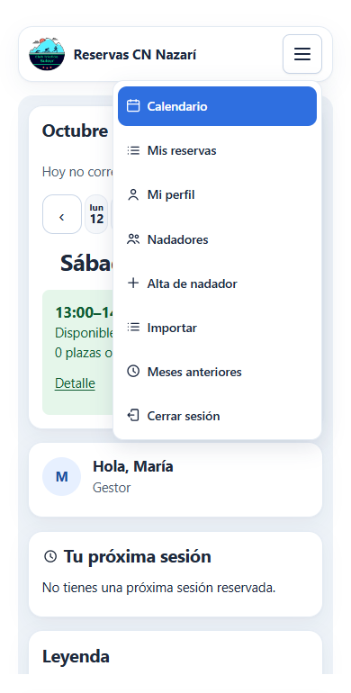
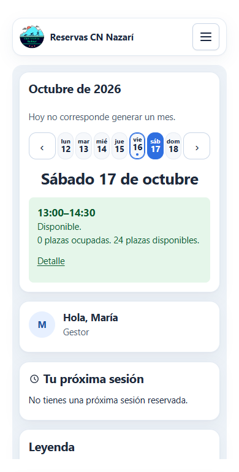
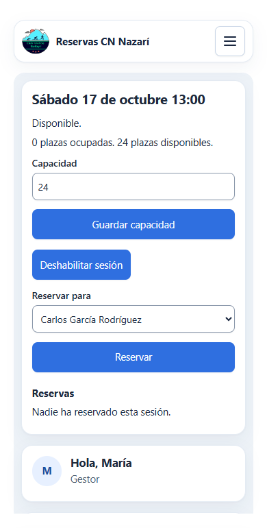
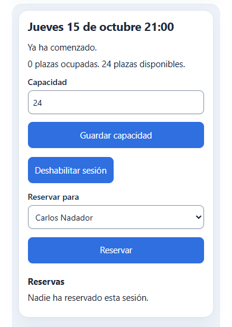
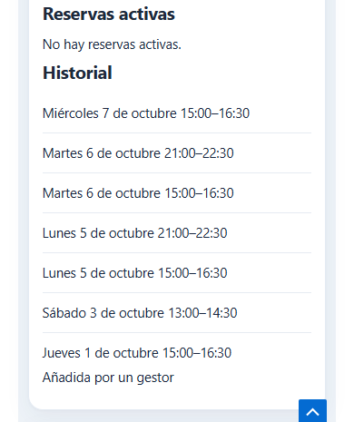
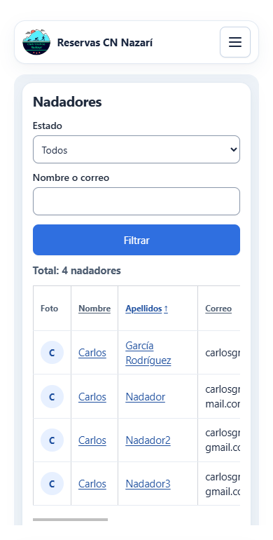
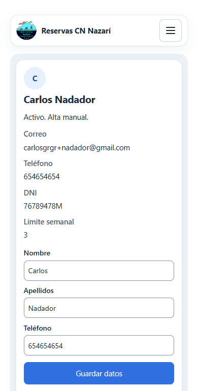
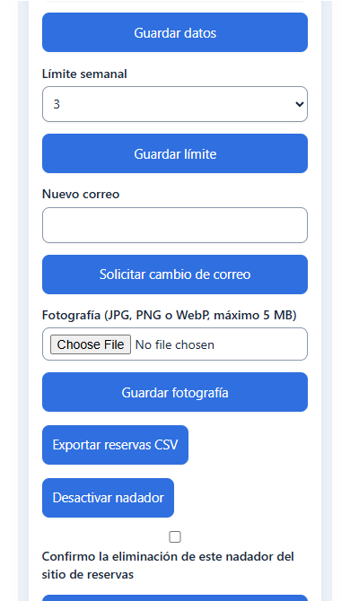
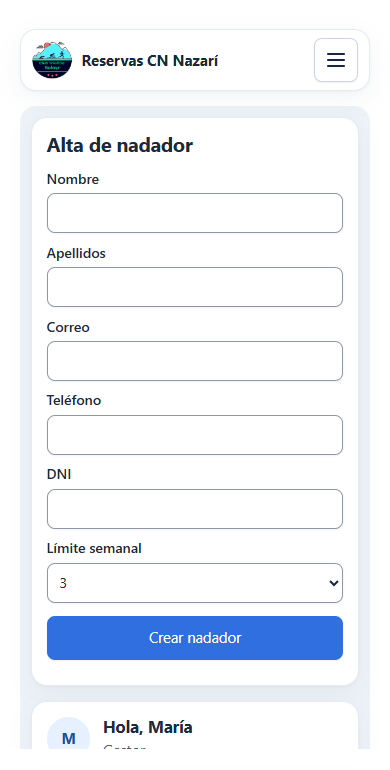

# Guía rápida del gestor

Reservas de natación, en el móvil. Hay una versión para el navegador en `GUIA-RAPIDA-GESTOR.html`.

## 1. Entrar y menú

Abre la web de reservas y pulsa **Iniciar sesión**. El botón de las tres rayas abre el menú.

## 2. Calendario

Se ve un día. Cambia de día con las flechas o tocando el día. **Detalle** abre la sesión.

Si aparece **Generar sesiones de…**, púlsalo una vez para crear el mes.

## 3. Gestionar una sesión

- **Guardar capacidad** cambia las plazas. Bajarlas no quita a quien ya está apuntado.
- **Deshabilitar sesión** la deja en el calendario, pero nadie puede reservarla.
- **Reservar para** y **Reservar** apuntan a un nadador.
- **Cancelar reserva**, en la lista, libera esa plaza.

Cada nadador tiene un máximo de reservas por semana, de lunes a domingo.

## 4. Apuntar a quien vino sin reservar

1. Vuelve al día de la sesión con la flecha de la izquierda.
2. Pulsa **Detalle**. La sesión dice «Ya ha comenzado».
3. En **Reservar para**, elige al nadador y pulsa **Reservar**.

En su historial sale con el texto «Añadida por un gestor». Cuenta en su límite de esa semana.

## 5. Nadadores

Arriba hay un **Contador** de todas las fichas: total, **CN Nazarí** y **CT Sulayr**, con activos e inactivos. No cambia al filtrar.

Puedes filtrar por estado, por origen (**CN Nazarí** o **CT Sulayr**) y por nombre o correo. Pulsa **Filtrar**. La columna **Origen** dice de cuál es cada ficha. El nombre abre la ficha.

## 6. Editar un nadador

- **Guardar datos**: nombre, apellidos y teléfono.
- **Guardar límite**: reservas por semana, de 1 a 5.
- **Solicitar cambio de correo**: llega un enlace al correo nuevo, válido 24 horas.
- **Guardar fotografía**.

Si no aparecen los campos de nombre o teléfono, esos datos no se cambian desde aquí.

**Desactivar nadador** impide reservar y borra sus reservas futuras; se puede volver a activar. **Pasar a CN Nazarí** lo ve solo un administrador: deja activa una ficha del club que sigue en natación después de la baja, y el club ya no la desactiva. **Eliminar nadador** borra la ficha y no se puede deshacer.

## 7. Alta de nadador

Rellena los cinco campos, elige el límite y pulsa **Crear nadador**. La persona recibe un correo para elegir su contraseña.

Para varias personas, usa **Importar** con la plantilla.
