# Guía rápida del nadador

Reservas de natación, en el móvil. Hay una versión para el navegador en `GUIA-RAPIDA-NADADOR.html`.

## 1. Entrar

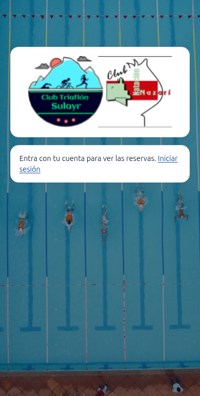

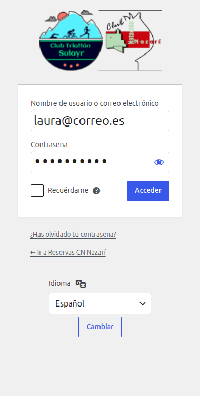

Abre la web de reservas y pulsa **Iniciar sesión**. Escribe tu correo y tu contraseña y pulsa **Acceder**.

- Si eres deportista del club, usa el correo y la contraseña de siempre.
- Si te dieron de alta desde reservas, te llegó un correo para elegir la contraseña.
- Si no la recuerdas, pulsa **¿Has olvidado tu contraseña?**.

## 2. Menú

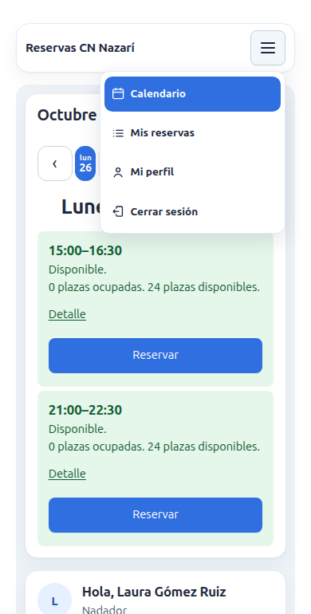

El botón de las tres rayas abre el menú:

- **Calendario**: las sesiones y el botón para reservar.
- **Mis reservas**: tus plazas y tu historial.
- **Mi perfil**: tus datos, correo, foto y contraseña.
- **Mi perfil en el club**: solo si también eres deportista del club.
- **Cerrar sesión**.

## 3. Calendario

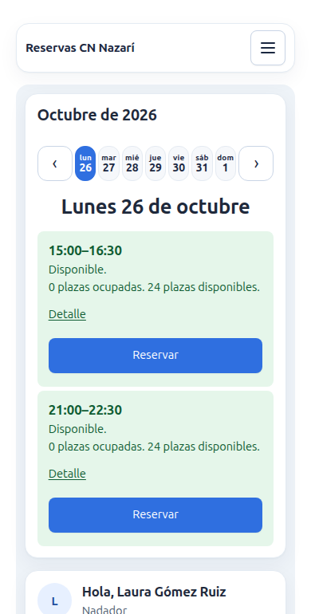

Se ve un día. Cambia de día con las flechas, tocando el día arriba o deslizando el dedo hacia los lados.

Cada sesión indica su hora y su estado, y cuántas plazas quedan:

- **Disponible**: puedes reservar.
- **Reservada por ti**: ya tienes plaza.
- **Completa**: no quedan plazas.
- **Deshabilitada**: no admite reservas.
- **Ya ha comenzado**: ya no se puede reservar.

Horario habitual: de lunes a jueves de 15:00 a 16:30 y de 21:00 a 22:30, y los sábados de 13:00 a 14:30. Los viernes y los domingos no hay sesión.

## 4. Reservar una sesión

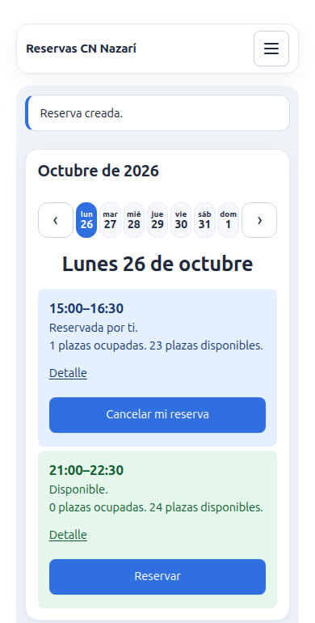

1. En el **Calendario**, busca el día y una sesión **Disponible**.
2. Pulsa **Reservar**.
3. Arriba sale «Reserva creada.» y la sesión pasa a **Reservada por ti**.

No podrás reservar si la sesión está completa, deshabilitada o ya ha empezado, si ya tienes plaza en ella o si has llegado a tu límite de la semana.

## 5. Límite semanal

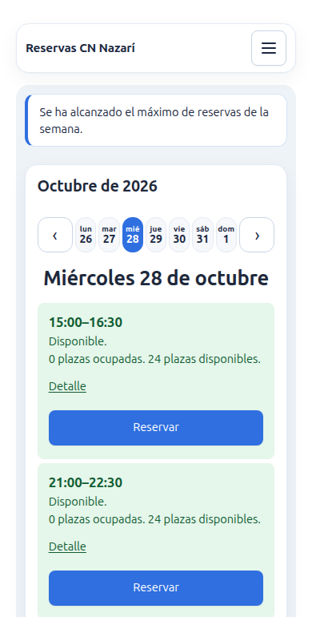

Cada nadador puede reservar un número máximo de sesiones por semana. Lo pone el gestor, entre 1 y 5. Si no lo ha cambiado, es 3.

- La semana va de **lunes a domingo**, según el día de la sesión, no el día en que reservas.
- Al llegar al máximo sale «Se ha alcanzado el máximo de reservas de la semana.» y no se crea la reserva.
- Si cancelas una reserva de esa semana, vuelves a tener hueco.
- Si el gestor te apunta a una sesión, también cuenta.

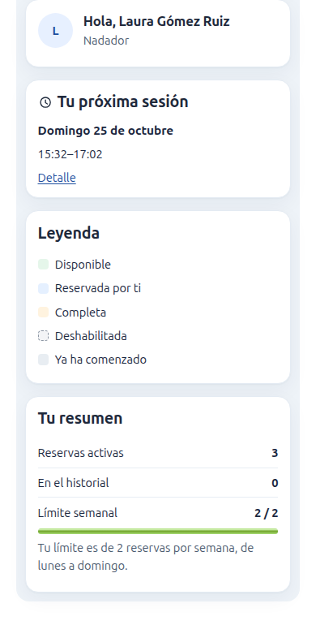

En el **Calendario**, más abajo, **Tu resumen** muestra cuántas reservas llevas esta semana y tu límite, por ejemplo **2 / 2**. **Tu próxima sesión** te recuerda la siguiente que tienes.

## 6. Mis reservas

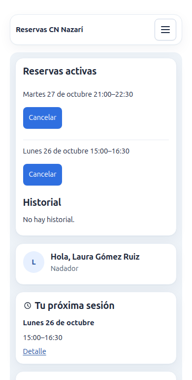

- **Reservas activas**: sesiones que todavía no han empezado. Junto a cada una está **Cancelar**, si aún estás a tiempo.
- **Historial**: sesiones a las que ya fuiste. Si el gestor te apuntó, pone «Añadida por un gestor».

## 7. Cancelar una reserva

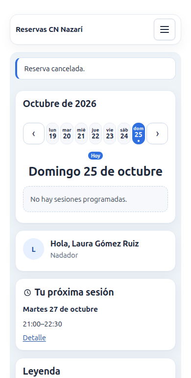

1. Entra en **Mis reservas**, o abre el día de la sesión en el **Calendario**.
2. Pulsa **Cancelar** (o **Cancelar mi reserva** en el calendario).
3. Arriba sale «Reserva cancelada.».

La plaza queda libre para otra persona y deja de contar en tu límite de esa semana.

## 8. Menos de una hora antes: ya no se puede cancelar

Solo puedes cancelar hasta **una hora antes** del inicio. Por ejemplo, en una sesión de las 21:00 puedes cancelar hasta las 20:00 en punto.

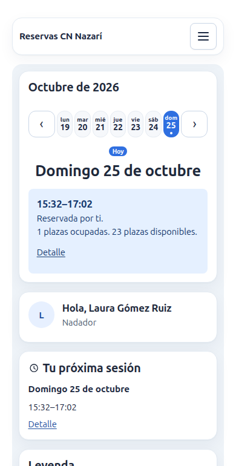

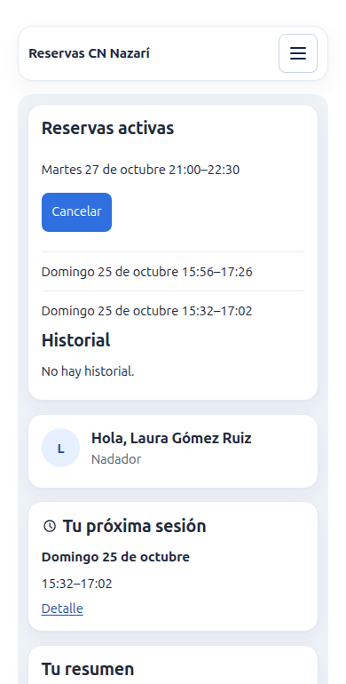

Cuando falta menos de una hora, el botón **Cancelar** desaparece, en el calendario y en **Mis reservas**. La plaza sigue siendo tuya.

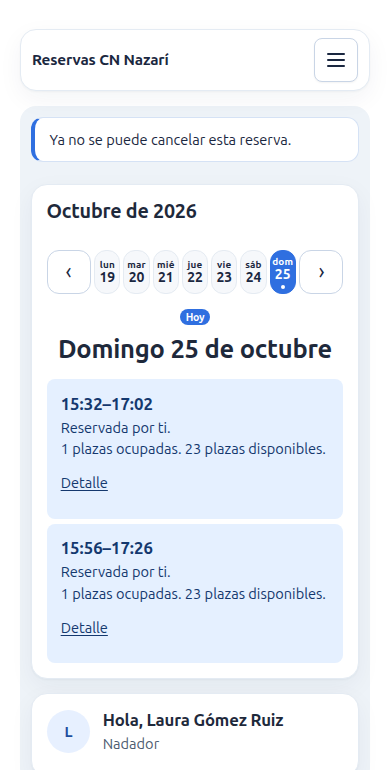

Si tenías la página abierta desde antes y pulsas **Cancelar** fuera de plazo, sale «Ya no se puede cancelar esta reserva.» y la reserva no se borra.

> Si no vas a poder ir y falta menos de una hora, avisa al gestor. Solo el gestor puede cancelarla.

## 9. Mi perfil

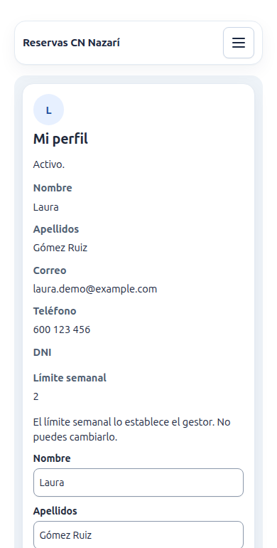

Ves tu nombre, apellidos, correo, teléfono, DNI y tu límite semanal. El límite solo lo cambia el gestor.

- Nombre, apellidos o teléfono: cámbialos y pulsa **Guardar datos**. Si eres deportista del club, estos datos no salen para editar: los mantiene el club.

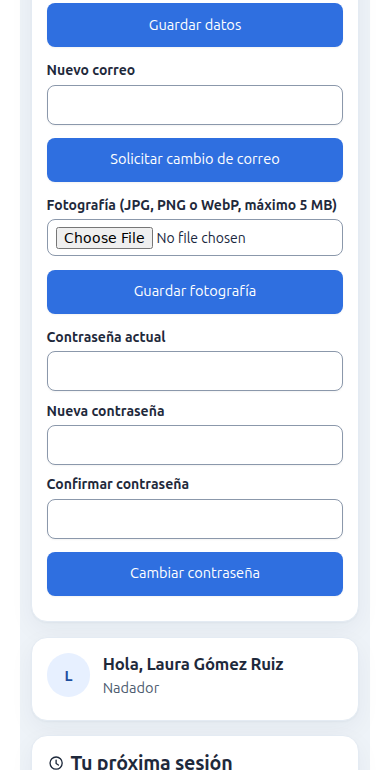

- **Solicitar cambio de correo**: llega un enlace al correo nuevo. Tienes 24 horas para abrirlo. Hasta entonces sigues entrando con el anterior.
- **Guardar fotografía**: JPG, PNG o WebP, hasta 5 MB.
- **Cambiar contraseña**: escribe la actual y dos veces la nueva.

## 10. Cerrar sesión

En el menú, pulsa **Cerrar sesión**. Se cierra a la vez en reservas y en la web del club.

## 11. Si algo no sale

| Lo que ves | Qué hacer |
|---|---|
| «Entra con tu cuenta para ver las reservas» | Pulsa **Iniciar sesión** |
| «No puedes acceder al sistema de reservas» | Tu ficha está desactivada. Habla con el gestor |
| «No quedan plazas» | Elige otra sesión |
| «Se ha alcanzado el máximo de reservas de la semana» | Cancela otra de esa semana o reserva en la siguiente |
| «Ya no se puede cancelar esta reserva» | Falta menos de una hora. Avisa al gestor |
| No aparece el botón **Cancelar** | Falta menos de una hora, o la sesión ya empezó |
